# The Cuss You Are?!

A playful browser-based generator that combines a name with three randomly selected phrase parts.

**HTML · CSS · JavaScript**

[Visit the website](https://samobrienolinger.github.io/The-Cuss-/) · [Getting started](#getting-started) · [Data model](#entity-relationship-diagram) · [Repository guide](#repository-guide) · [Checks](#checks-and-review) · [Credits](#credits-and-reuse)

## What you can explore

- Enter a name.
- Generate the beginning, middle and ending of a phrase.
- Repeat the sequence to explore different combinations.

## Entity relationship diagram

The generator combines an entered name with three phrase slots. Each slot draws from its own list, and the final message combines the selected phrases in order. The browser holds the selections in the page. [Phrase lists and generator](assets/js/script.js)

[](docs/diagrams/the-cuss-you-are-phrase-generator.svg)

## Getting started

Requires Git, a browser and a local HTTP server. Python 3 provides one without installing application packages.

```bash
git clone https://github.com/SamOBrienOlinger/The-Cuss-.git
cd The-Cuss-
python3 -m http.server 8000 --bind 127.0.0.1
```

Open [localhost:8000](http://localhost:8000). Serve the repository over HTTP so module imports, relative assets and page links resolve correctly.

## Repository guide

| Path | Purpose |
| --- | --- |
| [index.html](index.html) | Primary browser entry point |
| [assets/](assets/) | Project styles, scripts, data and imagery |

## Checks and review

No automated application test command is configured in this snapshot.

For a manual review, follow the main user journey, check keyboard navigation and narrow-screen layouts, and inspect the browser console for missing assets or failed requests.

## Deployment

A GitHub Pages site is configured for this repository. Its published URL is linked at the top of this README.

## Credits and reuse

No repository-level licence file is present in this snapshot. This README does not grant additional reuse permissions. Check with the relevant rights holders before reusing code, written content or assets.

## Support

Repository maintained in [Sam O’Brien-Olinger’s GitHub account](https://github.com/SamOBrienOlinger). For a problem or suggested improvement, [open an issue](https://github.com/SamOBrienOlinger/The-Cuss-/issues) with the affected page or command, steps to reproduce, and expected behaviour.

[Back to top](#the-cuss-you-are)
